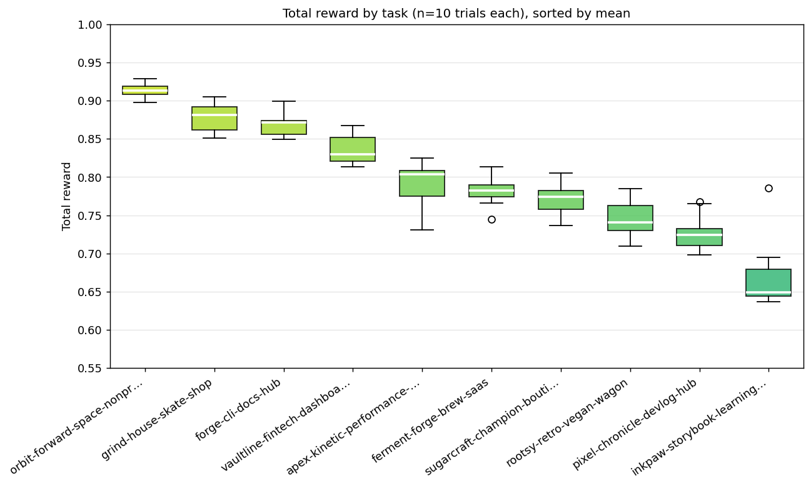
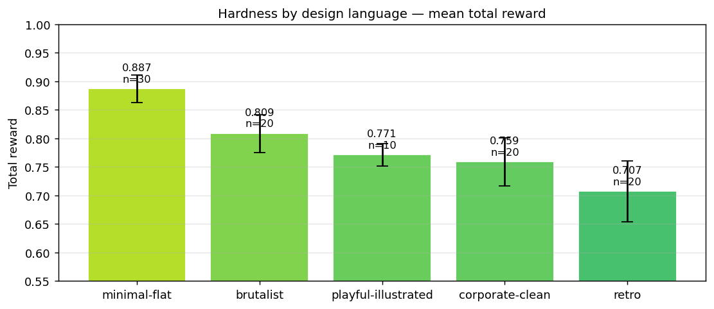

Claude Code with Opus 4.7 rebuilds a multi-page website from screenshots well, but not perfectly. Over 100 trials it scored a mean reward of 0.80. The oracle, which hands the grader the original site, scored 0.98. That leaves the agent about 0.18 below the ceiling.

I built [design2code-rl](https://github.com/gpahal/design2code-rl) to measure this. It generates websites, asks an agent to rebuild them from screenshots and grades the result on a continuous scale.

## Why build it

Most screenshot-to-code benchmarks, such as Design2Code and Web2Code, test a single page. Real sites have several pages that share a nav, a footer and a brand. A multi-page task is harder, and it shows failures a single page hides, like colours drifting from one page to the next.

I also wanted a reward that could train a model, not only rank one. Pass or fail gives no gradient. A score between 0 and 1 does.

## How it works

The pipeline generates 50 sites from scratch, each with five or more pages. Claude Sonnet writes a concept for each one: a category such as a dashboard or a docs site, a brand and a design language. Claude Opus then writes the HTML and CSS, shared regions first so the pages stay consistent. Playwright renders every page at desktop and mobile sizes, and a screener rejects broken or incoherent sites.

Each site becomes a [Harbor](https://github.com/harbor-framework/harbor) task. The agent gets the screenshots and has to produce the site. Trials run on [Modal](https://modal.com/).

The grader re-renders the agent's pages and scores four things:

- Visual fidelity (70%): three Opus 4.7 judge calls compare desktop and mobile screenshots of each page against the original
- Text (15%): whether the headings, nav labels and body copy match
- Code quality (7.5%): valid, semantic, responsive and accessible markup
- Consistency (7.5%): whether brand colours stay stable across pages

The judge sees only screenshots, never code, so any markup that looks right can score well. For the eval I picked 10 varied sites and ran Claude Code 10 times on each.

## What was easy and what was hard

The site decided the score far more than the attempt did. Within a site, the standard deviation stayed under 0.05. Across sites, means ranged from 0.91 for a minimal space nonprofit to 0.67 for a retro storybook education site.

Minimal layouts were easy. The three minimal sites scored 0.87 to 0.91, and form pages such as donation, contact and reservation flows scored highest of all.

Retro was the hardest design language, about 0.18 below minimal. The agent dropped decorative type, background patterns and ornaments. It also pushed muted palettes towards vivid web colours. Dense grids of articles, products or schedules scored poorly too, worst when combined with decorative styling.

Much of the lost score is imagery the agent cannot draw: about 60% of the judge's lost points came from photos and illustrations. Some failures don't show at all. Every trial wrote responsive CSS, but accessibility scored 0.44, because alt text and heading order were often missing. The prompt didn't ask for them.

## Outcome

The environment gives a reward that separates easy sites from hard ones and stays stable across attempts at the same site, which is what training needs. Claude Code is already good at plain, minimal sites. The remaining gap is in decorative styles, dense layouts and imagery.

Next I plan to build more evals like this, and RL environments for much more complex and involved tasks, where a reward can do more than rank models: it can help train better ones.

## Resources

- [design2code-rl](https://github.com/gpahal/design2code-rl), the pipeline, grader and dataset
- [Visual report](https://github.com/gpahal/design2code-rl/blob/main/docs/VISUAL_REPORT.md), with scores per site, page and dimension
- [Failure patterns](https://github.com/gpahal/design2code-rl/blob/main/docs/FAILURES.md), with side-by-side screenshots
- [Grading](https://github.com/gpahal/design2code-rl/blob/main/docs/GRADING.md), on how the grader was calibrated
