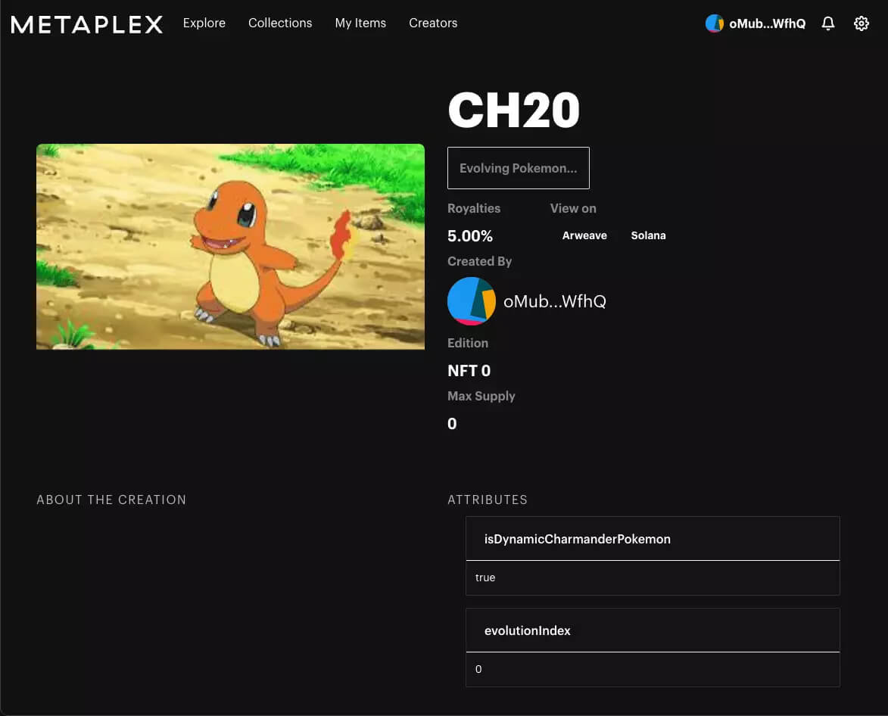
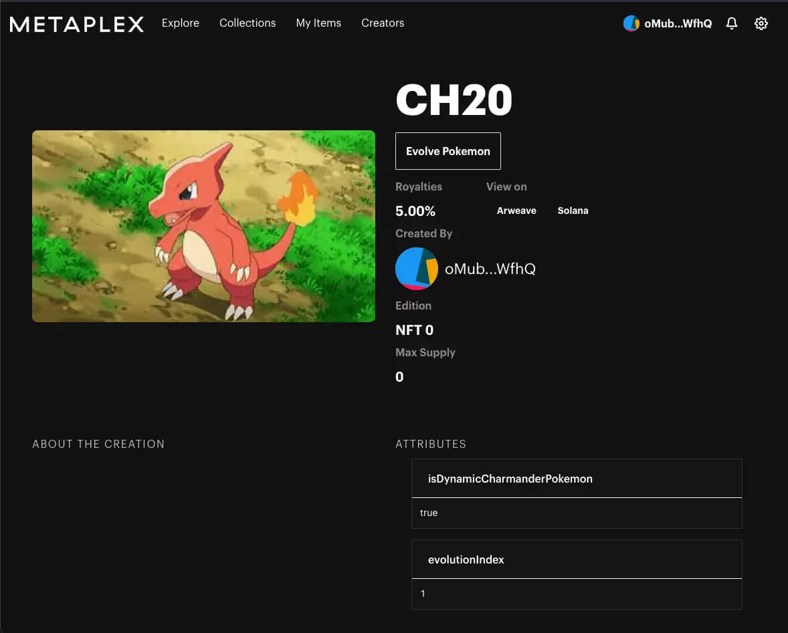
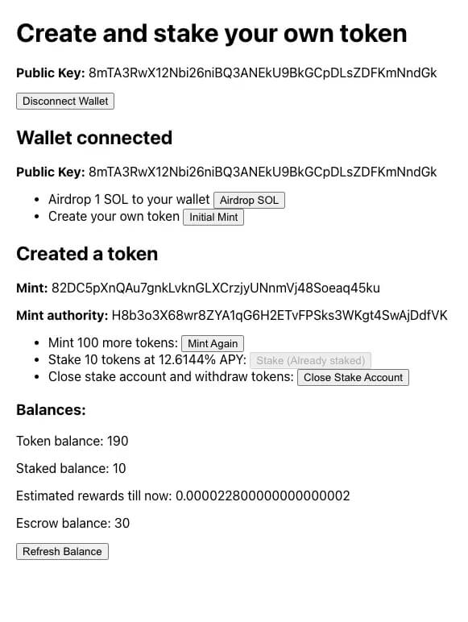

I had been learning Rust for two or three months when I came across Solana. I went deeper into web3: I bought some SOL, created a wallet, used Solana apps and read a lot.

Solana spoiled me. I expected every blockchain to be fast and to have wallets as good as [Phantom](https://phantom.com/). Ethereum, which I tried next, was much worse: \$80 gas fees, slow transactions and an unintuitive MetaMask.

## Getting into the fellowship

I wanted to work full-time in web3, and around then I saw the fellowship on [SuperteamDAO's](https://x.com/SuperteamDAO) Twitter. Superteam helps promising Solana projects in India, South-East Asia, Eastern Europe and Africa launch and grow, and I had been following its [podcasts](https://www.youtube.com/channel/UCi-pkXLbm7sqXFhV1NBLUfQ).

The [fellowship](https://web.archive.org/web/20220106144208/https://solana-india-fellowship.devfolio.co/) was an eight-week programme to learn Solana and build apps for it. Each week had a new theme, from NFTs to DeFi to gaming, with quests, exercises and Q\&A sessions with experts, and fellows got a \$2,500 stipend. I filled out a few application forms, gave an in-person interview and got in a week later.

## Week 1: Getting started

**In short:** Rust and Solana fundamentals: the ecosystem, the language and the programming model.

### Solana ecosystem and the fellowship

[Chase](https://x.com/therealchaseeb), from developer relations at Solana, opened with the ecosystem's growth over the last year, especially in India, and where he sees it going. [SOL dev\_](https://web.archive.org/web/20220405055138/https://soldev.app/) collects everything you need to develop on Solana. [Neil](https://x.com/neilshroff) and [Gnana Lakshmi](https://x.com/gyanlakshmi) then covered the fellowship's structure and goals.

### Rust

I had picked Rust as the language to learn last year and used it in a small side project, which is how I found Solana. I spent the week refreshing it with [Rustlings](https://github.com/rust-lang/rustlings) and [Exercism](https://exercism.org/tracks/rust), which both have short, progressively harder exercises you run locally. For video, try [Rust Programming Tutorials](https://www.youtube.com/playlist?list=PLVvjrrRCBy2JSHf9tGxGKJ-bYAN_uDCUL) and [Introduction to Rust for Solana](https://web.archive.org/web/20211128024016/https://questb.uk/quest/introduction-to-rust-for-solana-3b5a).

### Solana

The week before, I had read [Explaining Solana with The Simpsons](https://web.archive.org/web/20211201085846/https://learn.figment.io/tutorials/explaining-solana-with-the-simpsons) by [Jonathan Ferreira](https://x.com/JSoufer), the best introduction to Solana I have come across. Solana's own posts on why it's fast and secure had been too dense for me, and this one made them make sense.

This week covered the [programming model](https://web.archive.org/web/20220408124107/https://docs.solana.com/developing/programming-model/overview), [how to deploy to Solana](https://web.archive.org/web/20231231234819/https://openquest.xyz/quest/deploying-the-program-on-to-solana) and [how to work with interfaces to Solana like the SPL Token CLI](https://web.archive.org/web/20220514154128/https://openquest.xyz/quest/create_crypto_with_solana_cli). It was fun to finally use what I had read about.

## Week 2: Creating mini dApps

**In short:** My first dApps, with the [`@solana/web3.js`](https://web.archive.org/web/20220401091308/https://solana-labs.github.io/solana-web3.js/) library and an on-chain voting program.

### Web2 vs web3 development

[Preethi Kasireddy](https://x.com/iam_preethi) talked about how web3 differs from client-server programming. Web3 makes a global computer with persistent storage simple but iterative development much harder, so auditing and security reviews have to happen before deployment.

That matches my experience on Solana and Ethereum. The basics are the same (you still write Rust, Solidity or JS and keep a source of truth), but a lot changes once you build, deploy and combine components.

### Solana web3.js library

Two quests, [creating an airdrop program](https://web.archive.org/web/20220514154128/https://openquest.xyz/quest/create-an-airdrop-program-with-solana-web3.js) and [creating a roulette game](https://web.archive.org/web/20220401092219/https://openquest.xyz/quest/roulette_game_in_solana), used `@solana/web3.js` to interact with Solana and on-chain programs. They're easy if you know JavaScript. The library is simple and powerful, since you can move real money in a couple of lines, and better still with TypeScript's autocompletion.

### On-chain voting program

The exercise was a voting program with delegation ([the Solidity version](https://docs.soliditylang.org/en/v0.8.11/solidity-by-example.html)). I skipped the [Anchor framework](https://github.com/otter-sec/anchor): it makes programs simpler and safer, but I wanted to see what it abstracts away from the Solana program SDK.

It was harder than I expected. With no good starting point, I went through the Solana program library and found the [`name-service`](https://github.com/solana-labs/solana-program-library/tree/master/name-service) program the most helpful, since it was simple to follow. I made a template from it at [templates/program](https://github.com/gpahal/solana-fellowship/tree/main/programs/templates/program). With no UI to test the program, I learned to write integration tests for Solana, and seeing them pass was satisfying.

Not using Anchor showed me how useful it is, so I used it from then on.

## Week 3: More dApps

**In short:** Bigger programs, written with the Anchor framework.

### Anchor framework

[Anchor](https://github.com/otter-sec/anchor) provides an eDSL for writing Solana programs, an IDL anyone can use to generate a client, and a CLI with workspace management. After last week's sparse documentation and boilerplate, it was a relief. The tutorials and [The Anchor Book](https://www.anchor-lang.com/docs) took me from a new project to a working program quickly, and Solana development felt as simple as Solidity. Its documentation was limited too, as you'd expect from a young project under active development.

### On-chain programs

Three quests, [building a crowdfunding platform](https://web.archive.org/web/20250614232129/https://openquest.xyz/quest/building-a-crowdfunding-platform-using-solana), [setting up campaign accounts and sending money](https://web.archive.org/web/20250614234757/https://openquest.xyz/quest/setting-up-campaign-accounts-and-sending-money-on-solana) and [creating an on-chain calculator](https://web.archive.org/web/20220514154129/https://openquest.xyz/quest/solana-calculator), were easy after last week. The calculator was a good introduction to Anchor.

The exercise was a bi-directional payment channel ([the Solidity version](https://solidity-by-example.org/app/bi-directional-payment-channel/)), hard for a different reason. Ethereum's logic can't be copied over, because Solana handles where you store data, where you hold the treasury and how you manage it differently. Each time I thought the logic was done, another error taught me something new about the programming model. It took a day, and writing basic tests first kept the build and test cycle tight.

Anchor is excellent, but its documentation and examples are limited and its error messages sometimes unclear, so expect rabbit holes, test continuously and ask in the Anchor and Solana Discords.

## Week 4: NFTs

**In short:** NFTs on Solana, ending with dynamic NFTs that change over time.

### Creator ecosystem

[Jenil](https://web.archive.org/web/20211208150233/https://twitter.com/0xjenil) from [Coinvise](https://coinvise.co/) talked about communities, NFTs, tokens, DAOs and how to evaluate ideas in web3, where early projects and communities start and run very differently from web2 companies. That stayed with me as the project deadline came closer.

### NFTs

Two quests covered [creating and burning NFTs using `@solana/web3.js`](https://web.archive.org/web/20220121150757/https://openquest.xyz/quest/create-burn-nft-solana) and [creating your own NFT minting machine](https://web.archive.org/web/20220514154128/https://openquest.xyz/quest/create_a_candy_machine_minting_nft_and_minting_website_v2). I liked the second: I deployed a minting machine quickly, then read its code to see what was happening.

On Ethereum, where I had made NFTs before, you implement an interface (ERC-721 or ERC-1155) however you like. Metaplex, Solana's de facto NFT standard, is much more complex, partly because of Solana's programming model and partly for speed. Its tooling, documentation and UI code are excellent, though, and I leaned on them for the exercise.

### Dynamic NFTs

The exercise was an NFT marketplace with dynamic NFTs. I built Pokémon NFTs that start as Charmander and evolve into Charmeleon and then Charizard. I started from [Metaplex Storefront](https://web.archive.org/web/20220121074927/https://docs.metaplex.com/storefront/introduction) and added UI to create and evolve them, so the creator could click a button on the NFT's page to evolve it. The Metaplex APIs and Storefront's UI cache were the hardest part.

The creator still has to update the metadata by hand. Ideally an on-chain program would be the NFT's update authority and evolve it automatically, for example after enough time passes, but I ran out of time to build it.

## Week 5: DeFi

**In short:** Tokens, staking and tokenomics, including my own wallet and cryptocurrency.

### DAO treasuries and getting into web3

[Shreyas](https://x.com/HelloShreyas), co-founder of [Llama](https://web.archive.org/web/20220331225334/https://llama.xyz/), talked about economic infrastructure for DAO treasuries, building a community and why a product's name matters. His path into web3 matched mine: he left his job for a new industry and used hackathons to force himself to build. He found his problem by helping people with their DAOs, saw how hard managing treasuries was, and built a product and a community around it.

### Creating my own wallet and cryptocurrency

Three quests, [creating a wallet](https://web.archive.org/web/20220514154129/https://openquest.xyz/quest/create_personal_wallet), [creating your own crypto using Solana programs](https://web.archive.org/web/20220117164925/https://openquest.xyz/quest/solana-my-money) and [creating your own crypto using JavaScript](https://web.archive.org/web/20211229162046/https://openquest.xyz/quest/create_crypto_with_js), covered moving SOL and other SPL tokens. The first two used Solana's JSON RPC API. The last had us write a program that proxies calls to the SPL token program, and that ability to call other programs makes the ecosystem composable.

### Staking and tokenomics

The exercise was to add staking to the cryptocurrency from one of the quests. I had to decide where to escrow the funds, how to create escrow accounts for each token and how to tie it together in the UI.

It also got me thinking about tokenomics: why projects choose different distribution, inflation and reward mechanics, and how they implement them. Solana's [economics documentation](https://web.archive.org/web/20211227121250/https://docs.solana.com/economics_overview) is well written and explains why people stake and why spreading stake across validators matters for the network.

## Week 6: More complex dApps

**In short:** Harder dApps, and the problem my fellowship project would solve.

### dApps, dApps everywhere

There were four guided quests:

- [**Staking on Solana:**](https://web.archive.org/web/20220528001324/https://openquest.xyz/quest/staking-solana) how staking works under the hood, a good deep dive after a year of staking myself

- [**Building a messaging app on Solana:**](https://web.archive.org/web/20220126103944/https://openquest.xyz/quest/solana-messaging-app) a simple messaging program and its tests

- [**Building a decentralised identity verification system on Solana:**](https://web.archive.org/web/20220124062710/https://alexgrinman.com/posts/building-decentralized-identity-verification-system-on-solana/) worth trying if you've used ENS (.eth domains) or Bonfida (.sol domains), to see how services like them work

- [**Building a blog on Solana:**](https://web.archive.org/web/20211201081715/https://learn.figment.io/tutorials/build-a-blog-dapp-using-anchor) like the messaging app, but with a UI to play with

The exercise was a shared wallet that a group of friends could spend any SPL token from. I used the proxying technique from week 5 to create a proxy SPL token. It only transfers SPL tokens for now, but it could support any transaction, like multi-sig wallets such as Goki.

### Fellowship project

For my fellowship project, I chose streaming payments on Solana.

#### The problem

I came into the fellowship with this idea:

> Having worked at private remote companies, I have seen people having issues with ESOPs (transparency and illiquidity), global payroll and expense management.
>
> This is something I feel blockchain technology can solve, especially for newer-generation companies which are global, distributed and they want new structures for incentivisation and a seamless employee experience.

Meanwhile, startups in India and overseas were working on earned wage access: letting employees draw their wages as they earn them. Someone on 30k a month could withdraw \~15k on the 15th instead of waiting for the next month. Low-income employees need this when a sudden expense leaves them short at the end of the month, which otherwise drives them to predatory loans.

#### The solution

These problems reminded me of Superfluid, which I had used on Ethereum, and how easy solutions would be to build on something like it. The idea was a contract that lets a sender stream payments to a recipient, with:

- **Cliffs:** ESOPs usually have them, so the contract needs a way to codify them

- **Prepaid and unbounded streams:** ESOP streams need to be prepaid, so employees know their tokens are in escrow for the vesting schedule. Payroll and subscription streams are unbounded, and senders top up the escrow to keep them running

- **Solvency detection:** an unbounded stream that isn't topped up in time goes insolvent, so it has to be caught quickly and its sender penalised. Superfluid uses deposits and sentinels for this, and something similar would work here

Existing streaming payment projects on Solana lacked some of these features, and some were closed-source, so I couldn't tell whether they would add them.

## Week 7: Starting on my project

**In short:** Designing and building the first version of the project, and naming it Superstream.

I designed the project, finalised its scope and implemented most of the smart contract.

### Components

There would be four main components:

- Streaming contract
- Service that checks for insolvent streams
- JavaScript client for browser and Node.js apps
- Web UI for users to manage their streams

Any other project should be able to hook into them to add payment streaming. Insolvency is the most interesting part: how to detect it, decentralise detection and incentivise people to prevent it. I have some ideas but haven't settled on an approach.

### Naming the project

Probably the hardest decision of the week. I settled on **Superstream**, after Superteam.

### Future considerations

Transitive streams are one possibility. If Alice streams to Bob and Bob streams to Charles, the contract can let Bob take out only the net balance of both streams, so Charles's stream stays solvent as long as Alice keeps topping hers up. Ideas like this are complex and out of scope for now.

### Tech stack

- Smart contract in the [Anchor framework](https://www.anchor-lang.com/docs)
- Insolvency checker and JavaScript client in TypeScript
- Web UI in [Next.js](https://nextjs.org/) and TypeScript

## Superstream

The project took another month and is live at [superstream.finance](https://superstream.finance/). Superstream became a company, which I founded and ran from September 2021 to March 2022. More on my [work](/work) page.

## Closing thoughts

The eight weeks were fun and productive: I learned a lot, built a lot and met a lot of people. I'd recommend the fellowship to anyone who wants to learn to build Solana apps. If you have questions about it, reach me by [email](mailto:g10pahal@gmail.com) or on [X](https://x.com/g10pahal).
