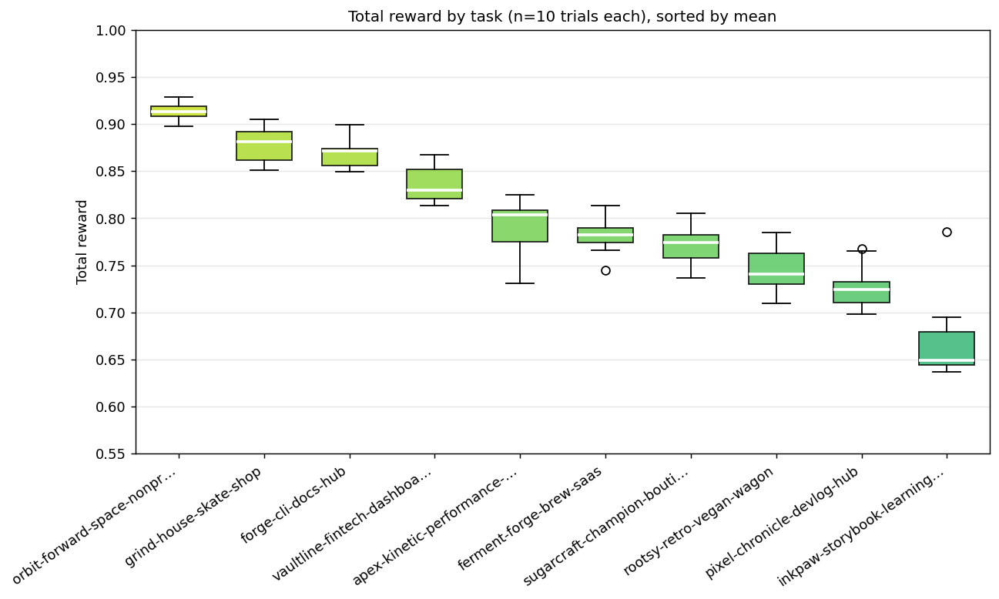

Claude Code with Opus 4.7 rebuilt multi-page websites from screenshots with a mean reward of 0.80 over 100 trials. The oracle, which feeds the original site back to the grader, scored 0.98.

## Why build it

Screenshot-to-code benchmarks such as Design2Code and Web2Code test one page. Real sites share a nav, a footer and a brand across pages, and drift between pages is a failure a single page cannot show. I also wanted a reward that could train a model as well as rank one. Pass or fail gives no gradient, so the grader returns a score between 0 and 1.

## How it works

The pipeline generates 50 sites of five or more pages. Claude Sonnet writes each concept (a category, a brand and a design language), Claude Opus writes the HTML and CSS with shared regions first, and a screener rejects broken sites once Playwright renders them.

Each site is a [Harbor](https://github.com/harbor-framework/harbor) task run on [Modal](https://modal.com/). The grader re-renders the agent's pages and scores:

- Visual fidelity (70%): three Opus 4.7 judge calls compare desktop and mobile screenshots of each page
- Text (15%): headings, nav labels and body copy
- Code quality (7.5%): valid, semantic, responsive and accessible markup
- Consistency (7.5%): brand colours across pages

The judge sees only screenshots, so any markup that looks right scores well. The eval ran Claude Code 10 times on each of 10 varied sites.

## Findings

The site decided the score far more than the attempt did. Within a site the standard deviation stayed under 0.05, while site means ran from 0.91 for a minimal space nonprofit to 0.67 for a retro storybook education site.

Retro was the hardest design language, about 0.18 below minimal, because the agent dropped decorative type, background patterns and ornaments. About 60% of the judge's lost points came from photos and illustrations the agent cannot draw. Accessibility scored 0.44, mostly for missing alt text and heading order.

Details are in the [visual report](https://github.com/gpahal/design2code-rl/blob/main/docs/VISUAL_REPORT.md), [failure patterns](https://github.com/gpahal/design2code-rl/blob/main/docs/FAILURES.md) and [grading calibration](https://github.com/gpahal/design2code-rl/blob/main/docs/GRADING.md).
