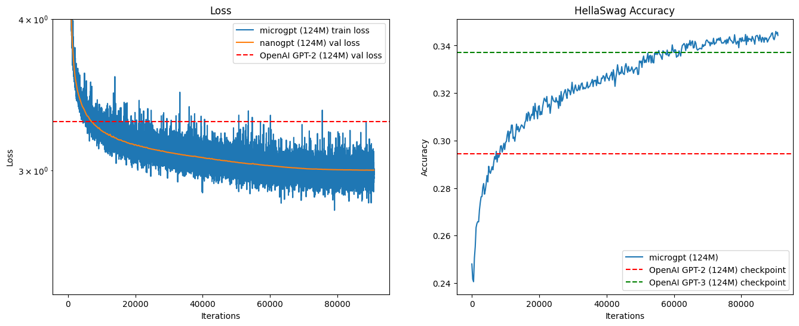

I pretrained a 124M-parameter GPT from scratch, and it peaked at 34.6% on HellaSwag, above OpenAI's GPT-2 (29.4%) and GPT-3 (33.7%) checkpoints of the same size. Training took about four hours on 8 H200 GPUs rented from [RunPod](https://www.runpod.io/) at \$32 an hour, about \$128 in all.

## Why build it

To learn attention, RoPE, multi-GPU training with checkpoints and two-stage training with weight averaging by building them. Post-training, mixture of experts and newer attention and normalisation variants were out of scope, since each adds cost.

## How it works

The library has a byte-pair encoding tokeniser I trained myself, a GPT model with RoPE, data loading from text, files, URLs or Hugging Face datasets, multi-GPU training with PyTorch DDP and a HellaSwag eval. The model has 12 layers, 12 heads, a width of 768 and a context of 1,024 tokens, trained in two stages:

1. A 10B-token sample of [FineWeb-Edu](https://huggingface.co/datasets/HuggingFaceFW/fineweb-edu), mostly web data
2. Three separate runs on smaller, high-quality data from [Cosmopedia](https://huggingface.co/datasets/HuggingFaceTB/cosmopedia) and Alpaca, with their weights averaged into one model

## Findings

The 34.6% peak came in stage 1, and the biggest lesson was data quality. Stage 1 saw about 48 billion tokens, against an [estimated 100 billion](https://x.com/karpathy/status/1795513568655487221) for GPT-2 and 300 billion for GPT-3's model of the same size. FineWeb-Edu keeps only the web pages a classifier judged educational, and the [FineWeb paper](https://arxiv.org/abs/2406.17557) found it matched another open dataset's MMLU score with almost 10 times fewer tokens. HellaSwag also suits a model trained on plain English web text, which likely gave up skills it doesn't test, such as code.

A script in the repo downloads the model and tokeniser, and the [notebooks](https://github.com/gpahal/microgpt/tree/main/notebooks) walk through them and the training charts. The project builds on Andrej Karpathy's [Neural Networks: Zero to Hero](https://www.youtube.com/playlist?list=PLAqhIrjkxbuWI23v9cThsA9GvCAUhRvKZ), [minbpe](https://github.com/karpathy/minbpe) and [nanoGPT](https://github.com/karpathy/nanoGPT).
