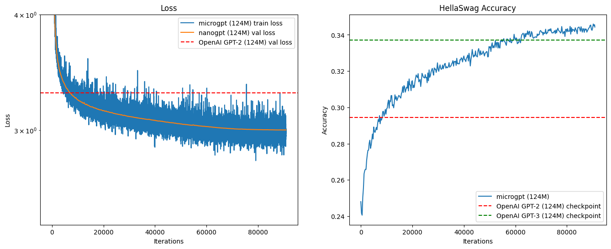

## The result

I pretrained a 124M-parameter GPT from scratch, and it peaked at 34.6% on HellaSwag. OpenAI's GPT-2 checkpoint of the same size scores 29.4%, and its GPT-3 one 33.7%. Training took about four hours on 8 H200 GPUs, about \$128 of GPU time.

## Why build it

I built microgpt to understand a few things by building them: attention and RoPE, training a model across several GPUs with checkpoints, and training in two stages, with the second stage's runs averaged into one model.

The model is deliberately plain. Post-training, mixture of experts and newer attention and normalisation variants were out of scope, because each one makes the project costlier.

## How it works

The library covers the whole path. It has a byte-pair encoding tokeniser I trained myself, a GPT model with RoPE, data loading from text, files, URLs or Hugging Face datasets, multi-GPU training with PyTorch DDP and a HellaSwag eval.

The model has 12 layers, 12 heads, a width of 768 and a context of 1,024 tokens. I trained it in two stages:

1. Stage 1 trained on a 10B-token sample of [FineWeb-Edu](https://huggingface.co/datasets/HuggingFaceFW/fineweb-edu), mostly web data
2. Stage 2 ran three separate runs on smaller, high-quality data from [Cosmopedia](https://huggingface.co/datasets/HuggingFaceTB/cosmopedia) and Alpaca, then averaged the three models' weights into one

Training ran on 8 H200 GPUs rented from [RunPod](https://www.runpod.io/) at \$32 an hour.

## Outcome

In stage 1, HellaSwag accuracy passed GPT-2's 29.4% early on and GPT-3's 33.7% later, peaking at 34.6%. A model the size of GPT-2, trained for about \$128, beat both of OpenAI's checkpoints of that size on this benchmark.

The biggest lesson was how much data quality matters. Stage 1 saw about 48 billion tokens, against an [estimated 100 billion](https://x.com/karpathy/status/1795513568655487221) for GPT-2 and 300 billion for GPT-3's model of the same size. FineWeb-Edu keeps only the web pages a classifier judged educational, and in the [FineWeb paper](https://arxiv.org/abs/2406.17557) it matched another open dataset's MMLU score with almost 10 times fewer tokens. HellaSwag also suits a model trained on plain English web text, which likely gave up skills it doesn't test, such as code.

The pretrained model and tokeniser can be downloaded with a script in the repo, and the [notebooks](https://github.com/gpahal/microgpt/tree/main/notebooks) walk through the tokeniser, the model and the training charts. The project builds on Andrej Karpathy's [Neural Networks: Zero to Hero](https://www.youtube.com/playlist?list=PLAqhIrjkxbuWI23v9cThsA9GvCAUhRvKZ), [minbpe](https://github.com/karpathy/minbpe) and [nanoGPT](https://github.com/karpathy/nanoGPT).
